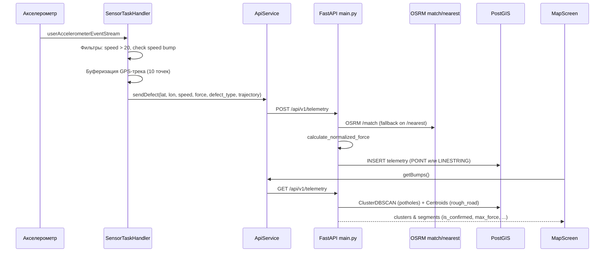

# Архитектура EasyRide

Карта исходников monorepo: **роль файла** и **публичные сущности**.  
Платформенные и генерируемые каталоги (`android/`, `ios/`, `build/`, `venv/`, `.dart_tool/` и т.п.) здесь не расписываются — не править без явной нужды.

См. также: [README.md](./README.md) · [AGENTS.md](./AGENTS.md)

---

## Общая схема



```
projects/
├── easyride_app/          # Flutter-клиент
│   └── lib/               # исходники UI и сервисов
└── easyride_backend/      # FastAPI + модели + Docker PostGIS
```

---

## Backend — `easyride_backend/`

```
easyride_backend/
├── main.py              # приложение FastAPI, эндпоинты, OSRM, нормализация
├── models.py            # ORM-модель телеметрии
├── database.py          # engine, сессии, Base
├── docker-compose.yml   # PostGIS 15
└── requirements.txt     # Python-зависимости
```

### `main.py`

Точка входа API. При старте: `CREATE EXTENSION postgis`, `create_all` таблиц.

| Сущность | Тип | Назначение |
|----------|-----|------------|
| `app` | `FastAPI` | Приложение `"EasyRide MVP API"` |
| `TelemetryPayload` | Pydantic model | `user_id`, `latitude`, `longitude`, `speed_kmh`, `bump_force`, `defect_type`, `infrastructure_type`, `trajectory` |
| `get_snapped_coordinates` | function | OSRM `/match` для трека; graceful fallback на `/nearest` для первой точки |
| `calculate_normalized_force(bump_force, speed_kmh)` | function | Нормализация силы удара относительно скорости (база 20 км/ч) |
| `health` | `GET /health` | Проверка БД и PostGIS |
| `receive_telemetry` | `POST` | Проверка `speed_kmh >= 20`, snap → normalize → insert `TelemetryData` |
| `get_telemetry` | `GET /api/v1/telemetry` | `ST_ClusterDBSCAN` → centroid, счётчики, `is_confirmed` |
| `resolve_location_wkt` | function | Определение итогового WKT (POINT или LINESTRING в зависимости от `defect_type`) |

**Правило подтверждения кластера:** `unique_users >= 2` **или** `total_hits >= 3`.

### `models.py`

| Сущность | Тип | Назначение |
|----------|-----|------------|
| `TelemetryData` | SQLAlchemy model | Таблица `telemetry`: `location` (Geometry `GEOMETRY`, SRID 4326), `defect_type`, `infrastructure_type` |

### `database.py`

| Сущность | Тип | Назначение |
|----------|-----|------------|
| `DATABASE_URL` | str | DSN Postgres (dev) |
| `engine` | Engine | SQLAlchemy engine |
| `SessionLocal` | sessionmaker | Фабрика сессий |
| `Base` | DeclarativeBase | База моделей |
| `get_db()` | generator | Dependency FastAPI: yield session, close в `finally` |

### `docker-compose.yml`

Сервис `db`: образ `postgis/postgis:15-3.3`, порт `5432`, volume `postgis_data`.

---

## Frontend — `easyride_app/lib/`

Дизайн-система «Полотно»: две темы (светлая «бетон» и тёмная «асфальт»), шрифты Unbounded (заголовки/цифры), Onest (интерфейс), JetBrains Mono (телеметрия) — через `google_fonts`.

```
lib/
├── main.dart                    # entry, MyApp (обе темы + ThemeController, home = AuthGate)
├── app_theme.dart               # токены PolotnoColors (light/dark), AppText, AppTheme, ThemeController
├── auth_gate.dart               # Session, AuthSession (мок-сессия), AuthGate (вход ↔ MainScaffold)
├── auth_screens.dart            # флоу входа: старт → номер → код → знакомство → доступы (+ клавиатура, OTP)
├── main_scaffold.dart           # shell + bottom nav: Карта / Дефекты / Запись / Профиль
├── map_screen.dart              # карта кластеров + капсула записи + шторка со статистикой
├── list_screen.dart             # лента дефектов: сводка с Полосой, фильтры, карточки
├── detect_screen.dart           # экран «Запись»: спидометр, осциллограф с порогом, журнал, foreground task
├── pothole_details_screen.dart  # карточка дефекта (данные API: force/users/hits/confirmed + мини-карта)
├── profile_screen.dart          # профиль: статы, Полоса поездки, медали, теплокарта
├── account_screen.dart          # аккаунт: номер, доступы, тема (переключатель), выход/удаление
├── app_state.dart               # AppState: ValueNotifier записи и скорости (капсула ↔ экран «Запись»)
├── defect_item.dart             # клиентская модель кластера + пороги степеней (Ровно/Заметно/Жёстко)
├── api_service.dart             # HTTP + in-memory логи (LogEntry: time/message/kind)
├── sensor_service.dart          # background TaskHandler акселерометра
└── widgets/
    ├── polotno.dart             # атомы: Tape, Ribbon, SeverityPill, CtaButton, CircButton, цвета степеней
    ├── defect_row.dart          # общая строка дефекта (шторка карты и лента)
    ├── glass_panel.dart         # стеклянный контейнер (цвета темы)
    └── onboarding_panel.dart    # запрос доступов перед первым стартом службы
```

### `main.dart`

| Сущность | Тип | Назначение |
|----------|-----|------------|
| `main()` | entry | `ensureInitialized`, init communication port, `runApp` |
| `MyApp` | StatelessWidget | `MaterialApp`: `AppTheme.light()/dark()` + `ThemeController.mode`, home = `AuthGate` |

### `app_theme.dart`

| Сущность | Тип | Назначение |
|----------|-----|------------|
| `PolotnoColors` | class (light/dark) | Токены темы: page, asphalt, surf, ink, mark (жёлтый), s1/s2/s3, glass, term |
| `PolotnoColors.of(context)` | static | Текущая тема по яркости |
| `AppText` | class | `display` (Unbounded), `lab`/`mono` (JetBrains Mono) |
| `AppTheme.light()/dark()` | ThemeData | Обе темы Material (Onest как основной шрифт) |
| `ThemeController` | static ValueNotifier | `ThemeMode` для MaterialApp и переключателя в «Аккаунте» |

### `auth_gate.dart` / `auth_screens.dart`

| Сущность | Тип | Назначение |
|----------|-----|------------|
| `Session` | class | Мок-профиль: phone, name, city, car |
| `AuthSession` | static ValueNotifier | Текущая сессия; `null` → флоу входа, иначе `MainScaffold` |
| `AuthFlow` | StatefulWidget | Шаги входа: старт, номер (маска +7, своя клавиатура), код (4 ячейки, таймер повтора, состояние ошибки), знакомство, доступы |

Авторизация моковая: серверной части нет, любой 4-значный код проходит (`0000` показывает состояние ошибки), `user_id` телеметрии не менялся.

### `main_scaffold.dart`

| Сущность | Тип | Назначение |
|----------|-----|------------|
| `MainScaffold` | StatefulWidget | `IndexedStack`: Карта / Дефекты / Запись / Профиль + стеклянный таб-бар (4 таба, без центральной кнопки) |

### `map_screen.dart`

| Сущность | Тип | Назначение |
|----------|-----|------------|
| `MapScreen` | StatefulWidget | `flutter_map`: тайлы по теме (voyager / dark_all), капсула записи со скоростью, шторка `DraggableScrollableSheet` со статистикой и ближайшими дефектами |
| `_loadBumps` / `_locateUser` / `_refresh` | methods | Данные API + GPS; кнопка «где я» |
| `onOpenFeed` / `onOpenRec` | callbacks | Переход на ленту / экран записи из шторки и капсулы |

Маркеры: подтверждённый кластер — цветной круг (степень по `max_force`), неподтверждённый — полый кружок, `rough_road` — цветной квадратик.

### `list_screen.dart`

| Сущность | Тип | Назначение |
|----------|-----|------------|
| `ListScreen` | StatefulWidget | Лента: сводка (всего/подтверждено + Полоса по степеням), чипы периодов, карточки `DefectRow` → `PotholeDetailsScreen` |

Дата в ответе API не отдаётся, поэтому фильтры периодов пока показывают все записи (заготовка).

### `detect_screen.dart`

| Сущность | Тип | Назначение |
|----------|-----|------------|
| `DetectScreen` | StatefulWidget | Экран «Запись». Реальная скорость (`Geolocator`), график вибраций (`sensors_plus`), терминал логов, старт/стоп foreground task |
| `_checkPermissionsAndStart` | method | Автостарт записи при наличии доступа, иначе пуш `OnboardingPanel` |
| `WaveformPainter` | CustomPainter | Живая волна оси Z + пунктир порога `SensorTaskHandler.bumpThreshold` (7 g) |

Состояние записи и скорость дублируются в `AppState` (для капсулы на карте).

### `pothole_details_screen.dart`

| Сущность | Тип | Назначение |
|----------|-----|------------|
| `PotholeDetailsScreen` | StatelessWidget | Карточка дефекта: заголовок со степенью и силой, факты (сила/водителей/попаданий), профиль удара, правило подтверждения, мини-карта, действия, комментарии (мок) |
| `item` | `DefectItem` | Данные кластера из API; комментарии и действия — декоративные |

### `profile_screen.dart` / `account_screen.dart`

| Сущность | Тип | Назначение |
|----------|-----|------------|
| `ProfileScreen` | StatelessWidget | Аватар с инициалами из `Session`, бейдж, 4 стата, Полоса последней поездки, медали, теплокарта. Шестерёнка → `AccountScreen` |
| `AccountScreen` | StatelessWidget | Номер, имя, доступы, порог записи, переключатель темы (`ThemeController`), выход/удаление (мок: сброс `AuthSession`) |

### `api_service.dart`

| Сущность | Тип | Назначение |
|----------|-----|------------|
| `ApiService` | class (static) | Клиент backend |
| `apiUrl` | const | `.../api/v1/telemetry` |
| `sendDefect` | static Future\<bool\> | `POST` телеметрии, поддерживает `trajectory` и `defect_type` |
| `getBumps()` | static Future\<List\<Map\>\> | `GET` кластеров |
| `LogEntry` / `LogKind` | class/enum | Строка журнала: time, message, kind (ok/hit/warn) |
| `addLog(message)` | static | Классифицирует эмодзи-префиксы isolate и пишет в `logs` |

### `sensor_service.dart`

| Сущность | Тип | Назначение |
|----------|-----|------------|
| `startCallback()` | entry-point | Регистрация `SensorTaskHandler` для isolate foreground task |
| `SensorTaskHandler.bumpThreshold` | static const | Порог удара 7.0 g (используется и графиком «Записи») |
| `SensorTaskHandler` | TaskHandler | Background isolate. Включает фильтры скорости и приватные методы детекции |
| `_isSpeedBump` | method | Анализ пиков по оси Z (игнор лежачих полицейских) |
| `_detectRoughRoad` | method | Анализ серии пиков по оси Y (боковая тряска) |
| `_updateTrajectory` | method | Ведение скользящего буфера `_trajectoryBuffer` (10 точек) |

### `defect_item.dart`

| Сущность | Тип | Назначение |
|----------|-----|------------|
| `DefectItem` | class | Модель кластера GET-ответа + `severity` и человекочитаемые заголовки |
| `defectSeverity(force)` | function | Степень 1/2/3 по порогам 3/5 (нормализация API прижимает силу вниз; пороги 20/30 из прототипа делали бы все дефекты «Ровно») |

### `widgets/`

| Сущность | Тип | Назначение |
|----------|-----|------------|
| `polotno.dart` | atoms | `Tape` (сигнальная лента), `Ribbon` (Полоса качества), `SeverityPill`, `CtaButton`, `CircButton`, `severityColor` |
| `defect_row.dart` | widget | Строка дефекта: мини-превью со степенью, координаты, пилюля, подтверждения, «Объезд» |
| `glass_panel.dart` | widget | Blur + полупрозрачный контейнер цвета `glass` темы (таб-бар, капсула, поиск) |
| `onboarding_panel.dart` | widget | Запрос доступов перед первым стартом службы (вызывается из `DetectScreen`) |

---

## Потоки данных (кратко)

### Запись ямы

1. `SensorTaskHandler.onStart` → stream акселерометра  
2. `force = sqrt(x²+y²+z²)` > `bumpThreshold`  
3. `Geolocator.getCurrentPosition` + `speed * 3.6`  
4. `ApiService.sendBump` → `POST /api/v1/telemetry`  
5. Backend: OSRM snap → `calculate_normalized_force` → `TelemetryData` в PostGIS  

### Чтение карты

1. `MapScreen._loadBumps` → `ApiService.getBumps`  
2. `GET /api/v1/telemetry` → кластеры  
3. `is_confirmed` → цветной `CircleMarker`, иначе серый `Marker`  

---

## Границы модулей (как задумано)

| Слой | Должен делать | Не должен |
|------|----------------|-----------|
| `sensor_service` | Датчики, порог, вызов API | UI, тема |
| `api_service` | HTTP, URL, логи-буфер | Виджеты, бизнес-пороги датчиков |
| Экраны (`*_screen`) | UI и навигация | Дублировать HTTP-логику (использовать `ApiService`) |
| `main.py` | HTTP + orchestration | (при росте) — разнести routes/services) |
| `models` / `database` | Схема и сессии | HTTP-ответы |

При добавлении файла или публичной функции — обнови этот документ.
