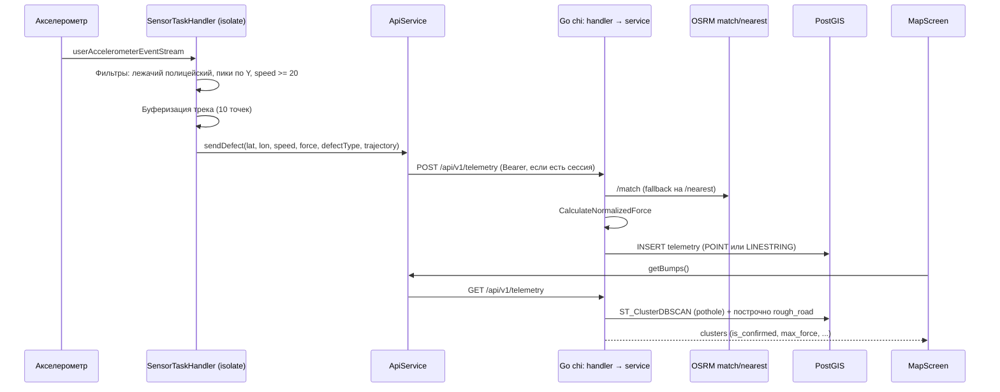
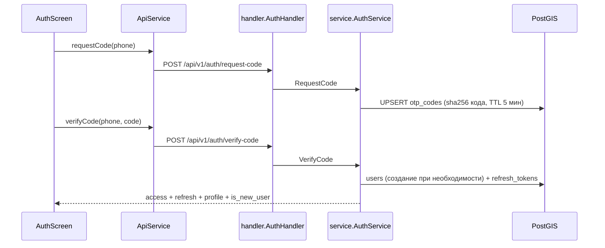

# Архитектура «Дорожного пульса»

Карта исходников монорепозитория: **роль файла** и **публичные сущности**.  
Платформенные и генерируемые каталоги (`app/android/`, `app/ios/`, `app/build/`, `.dart_tool/` и т.п.) здесь не расписываются — править их без явной нужды не нужно.

См. также: [README.md](./README.md) · [AGENTS.md](./AGENTS.md)

## 📒 Содержание

- [Общая схема](#-общая-схема)
- [Структура репозитория](#-структура-репозитория)
- [Сервис телеметрии](#-сервис-телеметрии)
- [Клиент](#-клиент)
- [Потоки данных](#-потоки-данных)
- [Границы модулей](#-границы-модулей)

## 🗺️ Общая схема



Авторизация:



## 📁 Структура репозитория

```
road_pulse/
├── app/                  # Flutter-клиент (package road_pulse)
│   ├── assets/fonts/     # Unbounded, Onest, JetBrains Mono
│   ├── assets/icon/      # logo.png
│   └── lib/              # исходники UI и сервисов
├── backend/              # Go 1.25 API (module road_pulse/backend)
│   ├── cmd/api/          # точка входа
│   └── internal/         # config, database, models, osrm, sms, service, handler
└── docs/                 # README.md, ARCHITECTURE.md, AGENTS.md
```

## 🧱 Сервис телеметрии

```
backend/
├── cmd/api/main.go                  # сборка зависимостей, chi-роутер, graceful shutdown
├── internal/config/config.go        # Config + Load() из ENV, падает без обязательных переменных
├── internal/database/database.go    # пул pgx, применение схемы
├── internal/models/telemetry.go     # DTO телеметрии, пробега и комментариев
├── internal/models/auth.go          # DTO авторизации, профиля и статистики
├── internal/models/trip.go          # DTO поездок
├── internal/osrm/client.go          # HTTP-клиент OSRM
├── internal/sms/sms.go              # Provider: HttpProvider и MockProvider
├── internal/service/telemetry.go    # бизнес-логика дефектов, кластеры, комментарии
├── internal/service/auth.go         # OTP, JWT, профиль, рейтинг, процентиль
├── internal/service/trip.go         # старт, финиш и чтение поездок
├── internal/service/*_test.go       # unit-тесты формул, телефона, хеша и токенов
├── internal/handler/telemetry.go    # HTTP-обработчики телеметрии и комментариев
├── internal/handler/auth.go         # HTTP-обработчики авторизации и профиля
├── internal/handler/trip.go         # HTTP-обработчики поездок
├── internal/handler/middleware.go   # RequireAuth / OptionalAuth
├── .env.example                     # шаблон переменных окружения
├── Dockerfile                       # multi-stage: сборка Go → alpine
├── docker-compose.yaml              # postgis/postgis:15-3.3 + api
└── go.mod / go.sum
```

### cmd/api/main.go

Порядок старта: `config.Load()` → `database.Connect` → `database.InitSchema` → сборка OSRM-клиента, сервисов и обработчиков → chi-роутер → `http.Server` (read/write timeout 10 с) → ожидание `SIGINT`/`SIGTERM` с 5-секундным shutdown.

| Сущность | Тип | Назначение |
|----------|-----|------------|
| `main()` | function | Точка входа, wiring, graceful shutdown |
| `GET /health` | inline handler | `SELECT PostGIS_Version()`; `200 {status, postgis}` либо `503 {detail}` |
| Роутер | `chi.Router` | `middleware.Logger`, `middleware.Recoverer` |
| Роуты `/api/v1/auth` | group | `request-code`, `verify-code`, `refresh`, `logout`; под `RequireAuth` — `GET`/`PATCH`/`DELETE /me` |
| Роуты `/api/v1/trips` | group | `POST /start`, `POST /finish`, `GET /last` под `RequireAuth` |
| Роут `/api/v1/telemetry` | group | `POST` и `POST /distance` под `OptionalAuth`, `GET` без авторизации, комментарии: `GET` публично и `POST` под `RequireAuth` |

### internal/config/config.go

| Сущность | Тип | Назначение |
|----------|-----|------------|
| `Config` | struct | `AppEnv`, `Port`, `DatabaseURL`, `OSRMBase`, `JWTSecret` |
| `Load()` | func | Чтение ENV; `DATABASE_URL` и `JWT_SECRET` обязательны (`log.Fatal` с подсказкой про `.env.example`); `APP_ENV` по умолчанию `development`; у OSRM читаются оба имени — `OSRM_BASE` и `OSRM_BASE_URL` |

Секрет JWT приходит в `main.go` из `cfg.JWTSecret` — отдельного `os.Getenv("JWT_SECRET")` больше нет. Провайдер SMS выбирается в `main.go` через `sms.NewProviderFromEnv()`: при заданном `SMS_API_KEY` это `HttpProvider`, в `production` без ключа — `log.Fatal`, иначе `MockProvider` с предупреждением в лог.

### internal/database/database.go

| Сущность | Тип | Назначение |
|----------|-----|------------|
| `Connect(ctx, dbURL)` | func → `*pgxpool.Pool` | Разбор DSN, `MaxConns=25`, `MinConns=2`, idle 5 мин, `Ping` с таймаутом 5 с |
| `InitSchema(ctx, pool)` | func | Идемпотентные миграции: `CREATE EXTENSION postgis`, таблицы, индексы (`idx_telemetry_user_id`, GIST по `location`, `idx_users_phone`) |

| Таблица | Ключевые поля |
|---------|---------------|
| `telemetry` | `id`, `user_id`, `location GEOMETRY(Geometry,4326)`, `speed_kmh`, `bump_force`, `defect_type`, `infrastructure_type`, `timestamp` |
| `users` | `id VARCHAR(64)` PK, `phone` UNIQUE, `name`, `city`, `car_clearance`, `total_distance_meters`, `streak_days`, `unlocked_achievements`, `created_at` |
| `otp_codes` | `phone` PK, `code_hash` (sha256), `attempts`, `expires_at`, `created_at` |
| `refresh_tokens` | `token_hash` PK, `user_id → users(id) ON DELETE CASCADE`, `expires_at`, `revoked`, `created_at` |
| `trips` | `id`, `user_id → users(id)`, `started_at`, `ended_at`, `distance_meters`, `defects_count`, `smooth_ratio`, `medium_ratio`, `hard_ratio`, `created_at` |
| `defect_comments` | `id`, `cluster_id`, `user_id`, `author_name`, `text`, `created_at` (индекс `idx_defect_comments_cluster_id`) |

### internal/models/telemetry.go

| Сущность | Тип | Назначение |
|----------|-----|------------|
| `TrajectoryPoint` | struct | `lat`, `lon`, `timestamp` |
| `TelemetryPayload` | struct | Вход POST: `user_id`, `latitude`, `longitude`, `speed_kmh`, `bump_force`, `defect_type`, `infrastructure_type`, `trajectory` |
| `TelemetryResponse` | struct | Ответ POST: `status`, `id`, `snapped_lat`/`snapped_lon`, нормализованный `bump_force`, типы дефекта и инфраструктуры, `geometry_type` |
| `TelemetryCluster` | struct | Элемент ответа GET: `cluster_id`, `lat`, `lon`, `max_force`, `unique_users`, `total_hits`, `is_confirmed`, `defect_type`, `infrastructure_type`, `created_at`, `coordinates` (для линий) |
| `DistancePayload` | struct | Вход `POST /telemetry/distance`: `distance_meters` |
| `DistanceResponse` | struct | Ответ: `status`, `added_meters`, `total_distance_meters` (накопленный итог пользователя) |
| `DefectComment` | struct | Комментарий: `id`, `cluster_id`, `user_id`, `author_name`, `text`, `created_at` |
| `CreateCommentPayload` | struct | Вход `POST /telemetry/comments`: `cluster_id`, `text`, `author_name` |

### internal/models/auth.go

| Сущность | Тип | Назначение |
|----------|-----|------------|
| `RequestCodePayload` | struct | `phone` |
| `VerifyCodePayload` | struct | `phone`, `code` |
| `RefreshTokenPayload` | struct | `refresh_token` |
| `UserProfile` | struct | `id`, `phone`, `name`, `city`, `car_clearance`, `total_distance_meters`, `total_defects`, `rating`, `saved_suspensions`, `community_percentile`, `streak_days`, `unlocked_achievements`, `created_at` |
| `AuthResponse` | struct | `access_token`, `refresh_token`, `user`, `is_new_user` |
| `UpdateProfilePayload` | struct | Указатели `name`, `city`, `car_clearance`, `streak_days`, `unlocked_achievements` (частичное обновление) |

Файл `internal/models/trip.go` описывает `Trip` и `TripPayload`: старт поездки, финиш с пробегом, числом дефектов и долями качества покрытия.

### internal/osrm/client.go

| Сущность | Тип | Назначение |
|----------|-----|------------|
| `Client` | struct | `baseURL` + `http.Client` с таймаутом 5 с |
| `NewClient(baseURL)` | func | Нормализует хвостовой `/` |
| `Nearest(ctx, lat, lon)` | method → `(lat, lon)` | `/nearest/v1/driving/{lon},{lat}`; при любой ошибке возвращает исходные координаты (fail open) |
| `Match(ctx, trajectory)` | method → `(wkt, geomType, ok)` | `/match/v1/driving/...?geometries=geojson&overview=full&timestamps=...`; конвертирует GeoJSON в WKT `LINESTRING`/`POINT` |

### internal/service/telemetry.go

| Сущность | Тип | Назначение |
|----------|-----|------------|
| `MinSpeedKMH` | const `20.0` | Нижний порог скорости для приёма телеметрии |
| `BaseSpeedKMH` | const `20.0` | База нормализации силы |
| `ClusterEpsDeg` | const `0.0003` | `eps` для `ST_ClusterDBSCAN` (≈ 33 м) |
| `TelemetryService` | struct | Пул `pgx` + OSRM-клиент |
| `NewTelemetryService(pool, osrm)` | func | Конструктор |
| `CalculateNormalizedForce(bumpForce, speedKMH)` | method → `float64` | `force × 20 / max(speed, 20)` |
| `ResolveLocationWKT(ctx, payload)` | method → `(wkt, geomType)` | Трек длиннее 2 точек → `/match`; `rough_road` остаётся `LINESTRING`, `pothole` усекается до первой точки; иначе `/nearest` → `POINT` |
| `SaveTelemetry(ctx, payload)` | method → `*TelemetryResponse` | Дефолты `pothole`/`road`, нормализация, `INSERT ... ST_GeomFromText($2, 4326) RETURNING id, ST_Y/ST_X(ST_Centroid(location))` |
| `GetClusters(ctx)` | method → `[]TelemetryCluster` | Два запроса: DBSCAN-кластеры ям и DBSCAN-кластеры линий `rough_road` (+ смещение `1000000` к `cluster_id`); в оба добавляются `created_at` и, для линий, GeoJSON-координаты |
| `RecordDistance(ctx, userID, meters)` | method → `*DistanceResponse` | Атомарный `UPDATE users SET total_distance_meters = COALESCE(total_distance_meters, 0) + $1 … RETURNING`; для пустого `userID` и `anonymous` запись в БД пропускается, итог возвращается нулевым |
| `AddComment(ctx, clusterID, userID, authorName, text)` | method → `*DefectComment` | `INSERT` в `defect_comments` с `RETURNING` |
| `GetComments(ctx, clusterID)` | method → `[]DefectComment` | Комментарии кластера по возрастанию времени |

**Правило подтверждения кластера:** `unique_users >= 2` **или** `total_hits >= 3` (считается на стороне Go, не в SQL).

### internal/service/auth.go

| Сущность | Тип | Назначение |
|----------|-----|------------|
| `ErrInvalidCode`, `ErrCodeExpired`, `ErrTooManyAttempts`, `ErrInvalidToken`, `ErrUserNotFound` | error | Типизированные ошибки для HTTP-слоя |
| `AuthService` | struct | Пул `pgx`, `jwtSecret` и `sms.Provider` |
| `NewAuthService(pool, secret, smsProvider)` | func | Секрет приходит из конфига; при `nil` подставляется `sms.NewMockProvider()` |
| `RequestCode(ctx, rawPhone)` | method → `(retryAfter, error)` | Генерация 4-значного кода, sha256 в `otp_codes` (UPSERT), TTL 5 мин; отправка через `sms.Provider`; возвращает 60 с |
| `VerifyCode(ctx, rawPhone, code)` | method → `*AuthResponse` | Не более 3 попыток, проверка TTL и хеша (мастер-кода нет); создаёт пользователя (`usr_<hash16>`) при отсутствии; выдаёт access (HS256, 24 ч) и refresh (32 байта hex, sha256 в БД, 60 дней) |
| `Refresh(ctx, oldToken)` | method → `*AuthResponse` | Проверка хеша, срока и `revoked`; ротация — старый refresh помечается `revoked` |
| `Logout(ctx, token)` | method → `error` | Отзыв refresh-токена |
| `ValidateAccessToken(tokenStr)` | method → `(userID, error)` | Проверка подписи HMAC и извлечение `sub` |
| `GetProfile(ctx, userID)` | method → `*UserProfile` | Профиль плюс `COUNT(*)` дефектов, рейтинг по четырём слагаемым, «подвесок спасено» и `PERCENT_RANK()` по активным пользователям |
| `UpdateProfile(ctx, userID, payload)` | method → `*UserProfile` | Частичное обновление профиля, а также `streak_days` и `unlocked_achievements` |
| `DeleteAccount(ctx, userID)` | method → `error` | Транзакция: анонимизация телеметрии и удаление пользователя |
| `normalizePhone`, `hashString`, `generateAccessToken`, `generateRefreshToken` | private methods | Нормализация номера, sha256, выпуск токенов |

Определение «нового» пользователя: пустые имя **или** город.

### internal/handler/

| Файл | Сущность | Тип | Назначение |
|------|----------|-----|------------|
| `telemetry.go` | `TelemetryHandler` / `NewTelemetryHandler` | struct / func | Обёртка над `service.TelemetryService` |
| `telemetry.go` | `PostTelemetry` | method | Разбор JSON (400), порог `MinSpeedKMH` (400 `Speed too low`), подстановка `user_id` из контекста или `anonymous`, `200` с `TelemetryResponse` |
| `telemetry.go` | `GetTelemetry` | method | Массив кластеров, `500` с `detail` при ошибке |
| `telemetry.go` | `PostDistance` | method | Разбор JSON (400), проверка `distance_meters > 0` (400), пользователь из контекста или `anonymous`, `200` с `DistanceResponse` |
| `telemetry.go` | `GetComments` / `PostComment` | methods | Чтение комментариев по `cluster_id` и добавление нового (автор — пользователь из JWT) |
| `trip.go` | `TripHandler` / `NewTripHandler` | struct / func | Обёртка над `service.TripService` |
| `trip.go` | `StartTrip`, `FinishTrip`, `GetLastTrip` | methods | Старт, финиш с агрегатами поездки и чтение последней поездки |
| `auth.go` | `AuthHandler` / `NewAuthHandler` | struct / func | Обёртка над `service.AuthService` |
| `auth.go` | `RequestCode`, `VerifyCode`, `Refresh`, `Logout`, `GetMe`, `UpdateMe`, `DeleteMe` | methods | Валидация payload, коды 400/401/404/500, ответы JSON |
| `middleware.go` | `ContextUserIDKey` | const `contextKey` | Ключ `user_id` в `context.Context` |
| `middleware.go` | `RequireAuth(authService)` | func → `func(http.Handler) http.Handler` | Обязательный `Authorization: Bearer`, иначе `401` |
| `middleware.go` | `OptionalAuth(authService)` | func → `func(http.Handler) http.Handler` | Пробрасывает `userID`, если токен валиден; гостевые запросы не блокирует |

### Dockerfile и docker-compose.yaml

- **Dockerfile**: сборка `CGO_ENABLED=0 GOOS=linux go build -ldflags="-w -s" -o /app/server cmd/api/main.go`, рантайм `alpine` с `ca-certificates` и `tzdata`, порт 8000. Базовый образ сборки — `golang:1.25-alpine`, как и требует `go.mod`.
- **Compose**: `db` (`postgis/postgis:15-3.3`, том `road_pulse_data`, БД `road_pulse_db`) и `api` (сборка из Dockerfile, порт `8001:8000`, ENV `DATABASE_URL`, `PORT`, `OSRM_BASE`, `JWT_SECRET`).

## 📱 Клиент

Дизайн-система «Полотно»: две темы (светлая «бетон» и тёмная «асфальт»), шрифты Unbounded (заголовки и цифры), Onest (интерфейс), JetBrains Mono (телеметрия) — из `assets/fonts/`.

```
lib/
├── main.dart                     # entry, MyApp, themeModeNotifier, AuthGate
├── app_theme.dart                # PolotnoColors (ThemeExtension), context.colors, AppTheme
├── constants.dart                # единые пороги: скорость, степени, одометр, батчи
├── calculations.dart             # чистые функции: рейтинг, бейдж, шаг, даты, фильтры
├── fresh_prefs.dart              # SharedPreferences с принудительным reload()
├── main_scaffold.dart            # shell + bottom nav: Карта / Дефекты / Запись / Профиль
├── map_screen.dart               # карта кластеров и линий + капсула + шторка маршрута
├── list_screen.dart              # лента дефектов: сводка с Полосой, фильтры, карточки
├── detect_screen.dart            # экран «Запись»: спидометр, пробег поездки, журнал, служба
├── pothole_details_screen.dart   # карточка дефекта: данные кластера и комментарии из API
├── profile_screen.dart           # профиль: статы с сервера, бейдж, поездка, достижения
├── achievement_service.dart      # каталог 30 достижений, локальный прогресс и пробег
├── api_service.dart              # HTTP, токены, логи, статистика, поездки, комментарии
├── sensor_service.dart           # background TaskHandler: акселерометр, трек, одометр
├── screens/
│   ├── auth_screen.dart          # флоу входа: старт → номер → код → имя → доступы
│   └── account_screen.dart       # аккаунт: профиль, доступы, выход, удаление
└── widgets/
    ├── glass_panel.dart          # стеклянный контейнер (цвета темы)
    ├── onboarding_panel.dart     # запрос доступов перед первым стартом службы
    └── road_ribbon.dart          # «Полоса» — лента качества покрытия
```

### main.dart

| Сущность | Тип | Назначение |
|----------|-----|------------|
| `themeModeNotifier` | `ValueNotifier<ThemeMode>` | Глобальное переключение темы (стартует с `ThemeMode.system`) |
| `main()` | entry | `ensureInitialized`, `initCommunicationPort`, `ApiService.recordAppOpen()`, `runApp` |
| `MyApp` | StatelessWidget | `MaterialApp`: светлая и тёмная темы + `themeModeNotifier`, home — `AuthGate` |
| `AuthGate` | StatefulWidget | `FutureBuilder<bool>` по `ApiService.isAuthenticated()`: ожидание → спиннер, авторизован → `MainScaffold`, иначе `AuthScreen`. На `AppLifecycleState.resumed` фиксирует вход в статистику активности |

### app_theme.dart

| Сущность | Тип | Назначение |
|----------|-----|------------|
| `PolotnoColors` | `ThemeExtension<PolotnoColors>` | Токены: `voidBg`, `asphalt`, `surf`/`surf2`, `edge`/`edge2`, `ink`/`ink2`/`ink3`, `mark*`, `s1`/`s2`/`s3` (+ `Soft`), `glass`, `glassTab`, `term`; пресеты `light` (`#EDEDEA`) и `dark` (`#08090A`) |
| `PolotnoThemeContext.colors` | extension on `BuildContext` | Доступ к токенам текущей темы |
| `AppTheme` | class | `fontUi = 'Onest'`, `fontDisplay = 'Unbounded'`, `fontMono = 'JetBrains Mono'`, `lightTheme`/`darkTheme` (Material 3) |

### main_scaffold.dart

| Сущность | Тип | Назначение |
|----------|-----|------------|
| `MainScaffold` | StatefulWidget | `IndexedStack` из `MapScreen` / `ListScreen` / `DetectScreen` / `ProfileScreen` + стеклянный таб-бар на 4 таба |
| `MainScaffold.of(context)` | static | Доступ к состоянию из потомков |
| `MainScaffoldState.switchTab(index)` | method | Переключение вкладки (используется картой для переходов) |

### map_screen.dart

| Сущность | Тип | Назначение |
|----------|-----|------------|
| `MapScreen` | StatefulWidget | `onNavigateToTab` — колбэк перехода на другую вкладку |
| `_locateUser` / `_loadBumps` | private methods | GPS-позиция и `ApiService.getBumps()` |
| `_buildCircles` | method | Подтверждённые кластеры: ореол и ядро, радиус и цвет по `max_force` (`> 30` — s3, `> 20` — s2, иначе s1) |
| `_buildMarkers` | method | Неподтверждённые кластеры — полые серые кружки |
| `_buildRecordCapsule` / `_buildSearchBar` / `_buildFloatingActionBtn` | methods | Верхние оверлеи карты (капсула «ЗАПИСЬ», поиск «Куда едем?», кнопки «где я» и слои) |
| `_buildDraggableSheet` | method | `DraggableScrollableSheet` (`0.22`/`0.38`/`0.85`): Полоса, стат-пилюли и «Ближайшие дефекты» — макет; `_buildDefectRow` рендерит захардкоженные строки |

Тайлы: `tile.openstreetmap.org`, в тёмной теме — `darkModeTileBuilder`.

### list_screen.dart

| Сущность | Тип | Назначение |
|----------|-----|------------|
| `ListScreen` | StatefulWidget | Лента: сводка (всего и подтверждено + Полоса по `max_force`) и карточки дефектов |
| `_filters` / `_applyFilter` | field / method | Чипы «Сегодня / Неделя / Месяц / Всё время» и сортировка по дате |
| `_parseDate` | method | `created_at` → `timestamp` → `DateTime.now()`: API дату не отдаёт, поэтому фильтры работают как заготовка |
| `_getAddress` | method | Обратное геокодирование (`geocoding`) для заголовка карточки |
| `_buildDefectCard` | method | Плейсхолдер-превью с бейджем S/M/L, координаты, `max_force` → РОВНО/ЗАМЕТНО/ЖЁСТКО, счётчик подтверждений, «Объезд», переход в `PotholeDetailsScreen` |
| `_buildEmptyState` / `RefreshIndicator` | widgets | Пустое состояние и обновление жестом |

### detect_screen.dart

| Сущность | Тип | Назначение |
|----------|-----|------------|
| `DetectScreen` | StatefulWidget | Экран «Запись»: реальные GPS и акселерометр, счётчик пробега поездки, старт и остановка foreground-службы; дерево обёрнуто в `WithForegroundTask` |
| `_tripDistanceMeters` / `_lastPos` | fields | Пробег поездки (приходит сообщением `TRIP:<метры>` из isolate) и последняя позиция для спидометра |
| `_checkPermissionsAndStart` | method | Автостарт при выданном доступе, иначе пуш `OnboardingPanel` |
| `_initForegroundTask` | method | `FlutterForegroundTask.init`: канал `road_pulse_tracking` («Road Pulse Tracking»), `eventAction.repeat(5000)`, wake/wifi lock |
| `_toggleTracking` | method | `startService(callback: startCallback)` / `stopService`; при старте обнуляет счётчик поездки, метры при этом считает isolate |
| `_onReceiveTaskData` | method | Логи и сообщения `TRIP:<метры>` из isolate → `ApiService.addLog` и счётчик поездки |
| `_initSensors` | method | Стрим позиции (`distanceFilter: 1`) для спидометра и стрим `userAccelerometer` для осциллографа; одометром экран не владеет |
| `_buildOdometerCard` | method | Карточка «ПРОБЕГ ЗА ПОЕЗДКУ» под спидометром: километры и метры в реальном времени |
| `_buildSpeedometer` / `_buildGateBanner` | methods | Крупная скорость и баннер: пробег пишется на любой скорости, удары — от 20 км/ч |
| `_buildScope` / `PolotnoScopePainter` | widget / CustomPainter | Осциллограф оси Z с пунктирным порогом 7 g (`_drawDashedLine`) |
| `_buildTerminal` | method | Журнал событий из `ApiService.logs` (последние 6 строк, классификация по префиксам) |

### profile_screen.dart

| Сущность | Тип | Назначение |
|----------|-----|------------|
| `ProfileScreen` | StatefulWidget | Секции: заголовок с инициалами из `ApiService.getUserProfile()`, ранговый бейдж сообщества, сетка статов, Полоса последней поездки из `GET /trips/last`, достижения, теплокарта |
| `_statsFuture` / `initState` / `RefreshIndicator` | field / hooks | Один общий `Future<UserStats>` на бейдж и сетку; пересоздаётся при открытии вкладки и по pull-to-refresh после `freshPrefs()` |
| `_buildCommunityBadge` | method | `FutureBuilder<UserStats>`: текст берётся из `communityBadgeText(rating, percentile:)` |
| `_buildLastTrip` | method | `FutureBuilder<TripData?>` по `ApiService.getLastTrip()` |
| `_buildStatsGrid` | method | `FutureBuilder<UserStats>`: дефекты, километры и метры трекинга, очки рейтинга с числом наград и дней серии, «подвесок спасено» |
| `_formatNumber` / `_formatKm` | static methods | Разряды через пробел и формат километров (два знака до 100 км) |
| `_buildAchievements` / `_showAchievementsSheet` | methods | Топ-8 достижений и шит «Все 30» (`_AllAchievementsSheet`) |
| `_buildActivityHeatmap` | method | Сетка 28 дней из `ApiService.getActivityData()` (серия, входы, активные дни) |
| `_formatStreak` / `_formatVisits` | static methods | Русские формы числительных |

### pothole_details_screen.dart

| Сущность | Тип | Назначение |
|----------|-----|------------|
| `PotholeDetailsScreen` | StatefulWidget | Карточка дефекта: принимает `defect` (кластер из API), показывает силу, тип, счётчики, правило подтверждения, мини-карту и комментарии из API; фото — плейсхолдеры |
| `_lat` / `_lon` / `_clusterId` | getters | Достают координаты и `cluster_id` из `defect`, без мок-значений |
| `_resolveAddress` | method | Обратное геокодирование адреса дефекта |
| `_commentsFuture` / `_reloadComments` | field / method | Загрузка комментариев через `ApiService.getComments` |
| `ImpactSpikePainter` | CustomPainter | График профиля удара |
| `MiniRoadPainter` | CustomPainter | Схематичная мини-карта |

Кластер передаётся параметром: и карта, и лента открывают экран с данными дефекта.

### achievement_service.dart

| Сущность | Тип | Назначение |
|----------|-----|------------|
| `Achievement` | class | `id`, `category`, `title`, `description`, `icon`, `current`, `target`, `isUnlocked`, `progressRatio` |
| `AchievementService.categories` | const list | «Все», «Старт», «Водитель», «Житель», «Порядочный гражданин», «Моя яма», «Доверие и сообщество» |
| `getAchievements()` | static Future | Каталог 30 достижений и прогресс из `SharedPreferences` (серия дней подтягивается из активности) |
| `getTotalDistanceMeters()` / `getTotalDistanceKm()` | static Future | Накопленный пробег из `SharedPreferences` |
| `addDistanceMeters(meters)` | static Future | Накопление километража, зачёт `first_km` и `thousand` |
| `syncDefectsProgress(count)` | static Future | Синхронизация `first_find`, `sharp_eye`, `road_scanner` по числу зачтённых дефектов |
| `checkCarProfile({model, tires, clearance})` | static Future | Зачёт `car_profile` |
| `increment(id, [delta])` | static Future | Инкремент произвольной записи прогресса |
| `_catalog`, `_loadRawProgress`, `_saveRawProgress` | private | Каталог и хранилище (стартовые значения для `first_km`, `first_find`, `sharp_eye`, `thousand`) |

### api_service.dart

| Сущность | Тип | Назначение |
|----------|-----|------------|
| `ApiService` | class (static) | Единая точка HTTP, токенов, логов, статистики, поездок и комментариев |
| `baseUrl` / `apiUrl` | const | Адрес API из `String.fromEnvironment('API_BASE_URL')` с прод-дефолтом |
| `logs` | `ValueNotifier<List<LogEntry>>` | Буфер журнала для экрана «Запись» |
| `addLog(raw)` | static | Чистит эмодзи-префиксы isolate и классифицирует запись в `LogKind.ok`/`hit`/`warn` |
| `LogEntry` / `LogKind` | class / enum | Строка журнала: время, текст, вид |
| `VerifyResult` | class | `success`, `isNewUser`, `errorMessage` |
| `DayActivity` / `UserActivityData` | class | Ячейка теплокарты (уровни 0–3) и агрегат за 28 дней (серия, входы, активные дни) |
| `recordAppOpen()` / `getActivityData()` | static Future | Учёт входов в `SharedPreferences` (хранение 90 дней) и сборка сетки 28 дней |
| `requestCode(phone)` / `verifyCode(phone, code)` | static Future | Авторизация; сохранение access/refresh токенов и профиля |
| `updateProfile({name, city, clearance})` | static Future | Локальное сохранение и `PATCH /auth/me` при наличии токена |
| `deleteAccount()` | static Future | `DELETE /auth/me` с последующей очисткой локальной сессии |
| `getAccessToken()` / `isAuthenticated()` / `getUserProfile()` / `logout()` | static Future | Работа с сессией (токены и профиль в `SharedPreferences`) |
| `UserStats` | class | DTO профиля: `totalKm`, `totalDefects`, `rating`, `savedSuspensions`, `unlockedAchievements`, `streakDays`, `communityPercentile` (+ `empty()`) |
| `getDefectsCount()` / `incrementDefectsCount([delta])` | static Future | Локальный счётчик зачтённых дефектов (`user_defects_count`) и синхронизация достижений |
| `getUserStats()` | static Future | Синхронизирует серию и награды через `PATCH /auth/me`, читает `GET /auth/me` (пробег, дефекты, рейтинг, процентиль) и прибавляет неотправленный буфер; при недоступности сервера падает на локальные счётчики и `ratingFor` |
| `sendDistance(meters)` | static Future\<bool\> | `POST /api/v1/telemetry/distance`; без токена возвращает `false`, и метры остаются в буфере |
| `flushPendingDistance()` | static Future | Досылает накопленный `pending_distance_meters` после входа в аккаунт |
| `sendDefect({...})` | static Future\<bool\> | `POST /api/v1/telemetry` с `Bearer`, если токен есть; принимает `defectType`, `infrastructureType`, `trajectory`; счётчик дефектов растёт **только** при ответе `200` |
| `startTrip()` / `finishTrip({...})` / `getLastTrip()` | static Future | `POST /trips/start`, `POST /trips/finish`, `GET /trips/last` |
| `TripData` | class | Поездка: `id`, `startedAt`, `endedAt`, `distanceMeters`, `defectsCount`, доли качества покрытия |
| `getComments(clusterId)` / `addComment({clusterId, text})` | static Future | `GET` и `POST /api/v1/telemetry/comments` |
| `DefectComment` | class | Комментарий: `id`, `clusterId`, `authorName`, `text`, `createdAt` |
| `getBumps()` | static Future\<List\<Map\>\> | `GET /api/v1/telemetry` |

`user_id` в теле POST не отправляется — сервис берёт его из JWT или помечает запись как `anonymous`.

### sensor_service.dart

| Сущность | Тип | Назначение |
|----------|-----|------------|
| `startCallback()` | entry-point (`@pragma('vm:entry-point')`) | Регистрация `SensorTaskHandler` в isolate foreground-задачи |
| `TrajectoryPoint` | class | Точка трека (`lat`, `lon`, `timestamp`) и `toJson()` |
| `SensorTaskHandler` | `TaskHandler` | Фоновый isolate: подписки на позицию (`distanceFilter: 1`) и `userAccelerometer` |
| `_pendingDistanceMeters` / `_lastDistancePosition` / `_lastDistanceSync` | fields | Буфер пробега, последняя позиция и время последней синхронизации |
| `SensorTaskHandler.bumpThreshold` | static const `7.0` g | Порог удара (используется и графиком экрана «Запись») |
| `_isSpeedBump(zForce)` | method | Игнор лежачих полицейских: пик по Z > 5.0 g длительностью < 300 мс → пауза 500 мс |
| `_detectRoughRoad(yForce)` | method | Более 4 пиков по Y > 4.0 g за 5 с → `rough_road`, сила `пики × 2`, диапазон 20–40 км/ч, блокировка на 5 с |
| `_detectPothole(event)` | method | `force = sqrt(x² + y² + z²) > 7.0` → `pothole`, скорость ≥ 20 км/ч, пауза 2 с |
| `_sendDefectData({...})` | method | `Geolocator.getCurrentPosition`, перевод в км/ч, фильтр по скорости, `ApiService.sendDefect` с буфером трека, отчёт в UI через `sendDataToMain` |
| `_updateTrajectoryAndDistance(position)` | method | Ведёт буфер трека (10 точек) и считает шаг: точность ≤ 80 м, длина 0.6–300 м — на любой скорости; метры идут в `AchievementService` и в буфер, который персистится в `pending_distance_meters` |
| `_checkAndSyncDistance({force})` | method | Отправляет буфер при ≥ 25 м, либо ≥ 5 м за 20 с, либо принудительно; при ошибке возвращает метры обратно в буфер |
| `_pauseMonitoring(ms)` | method | Временная блокировка детекции |
| `onStart` / `onRepeatEvent` / `onDestroy` | overrides | Жизненный цикл: старт стримов, периодическая проверка буфера (раз в 5 с), принудительный сброс остатка и отмена подписок |

### screens/auth_screen.dart

| Сущность | Тип | Назначение |
|----------|-----|------------|
| `AuthStep` | enum | `start`, `phone`, `code`, `codeError`, `name`, `access` |
| `AuthScreen` | StatefulWidget | Пошаговый вход через `switch (_step)` в `build` |
| `_handleRequestCode` | method | `ApiService.requestCode`, таймер повторной отправки 60 с |
| `_handleVerifyCode` | method | `ApiService.verifyCode`; новый пользователь → шаг `name`, существующий → `MainScaffold`; ошибка → `codeError` |
| `_handleSaveProfileAndContinue` | method | Валидация имени и города, `ApiService.updateProfile`, переход к `access` |
| `_onKeyPress` / `_buildKeypad` | methods | Своя цифровая клавиатура для шагов «номер» и «код» |
| `_formatPhone` | method | Маска `(###) ###-##-##` при префиксе `+7` |
| `_buildStartStep` / `_buildPhoneStep` / `_buildCodeStep` / `_buildNameStep` / `_buildAccessStep` | methods | Экраны шагов: оффер, номер, 4 ячейки кода, имя/город/клиренс, список доступов |

### screens/account_screen.dart

| Сущность | Тип | Назначение |
|----------|-----|------------|
| `AccountScreen` | StatefulWidget | Секции «ВХОД», «ЗАПИСЬ», «ОПАСНАЯ ЗОНА» и строка версии |
| `_loadAppVersion` | method | `PackageInfo.fromPlatform()` → «Дорожный пульс {версия} · сборка {номер}»; при ошибке — резервная строка из кода |
| `_loadProfile` | method | `ApiService.getUserProfile()` и марка/шины из `SharedPreferences` |
| `_showEditProfileDialog` | method | Диалог: имя, город, марка и модель, шины, клиренс; сохранение локально, зачёт `car_profile`, `PATCH /auth/me` |
| `_handleLogout` | method | `ApiService.logout()` → `AuthScreen` (используется и для «Удалить аккаунт») |
| `_buildGroupCard` / `_buildRowItem` / `_buildSectionHeader` | methods | Карточки-группы настроек |

### widgets/

| Сущность | Тип | Назначение |
|----------|-----|------------|
| `glass_panel.dart` → `GlassPanel` | widget | Blur и полупрозрачный `surf` с рамкой `edge`; параметры `blur`, `opacity`, `borderRadius`, `padding` |
| `onboarding_panel.dart` → `OnboardingPanel` | widget | Экран запроса доступов перед первым стартом службы (`onAllow`), анимация fade/slide, «магнитная» кнопка `_MagneticAllowButton` |
| `road_ribbon.dart` → `RoadRibbon` / `RibbonSegment` | widget / class | Лента качества из сегментов (`flex`, `color`) с маркером «вы здесь» (`currentPosition`) |

## 🔄 Потоки данных

### Запись ямы

1. `SensorTaskHandler.onStart` → стримы позиции и акселерометра.
2. `_isSpeedBump` отсекает лежачих полицейских; `_detectRoughRoad` и `_detectPothole` решают, что это дефект.
3. `Geolocator.getCurrentPosition` и перевод скорости в км/ч; фильтр ≥ 20 км/ч (для `rough_road` ещё и ≤ 40).
4. `ApiService.sendDefect(...)` → `POST /api/v1/telemetry` с `Bearer`, если есть сессия.
5. Сервис: `ResolveLocationWKT` (OSRM) → `CalculateNormalizedForce` → `INSERT` в PostGIS.
6. `ApiService.sendDefect` увеличивает локальный счётчик дефектов только при ответе `200`, поэтому статистика профиля считается по фактически принятым сервером записям.

### Одометр и статистика

1. Владелец одометра — фоновый isolate (`sensor_service`): точность ≤ 80 м, длина шага 0.6–300 м, ограничения по скорости нет. Экран «Запись» метры не считает, а получает счётчик поездки сообщением `TRIP:<метры>`.
2. Каждый шаг идёт в локальный счётчик `AchievementService.addDistanceMeters` и в буфер отправки, который персистится в `pending_distance_meters`.
3. Буфер уходит пачками: при ≥ 25 м либо ≥ 5 м за 20 с, плюс принудительно при остановке службы. Транспорт — `ApiService.sendDistance` → `POST /api/v1/telemetry/distance`; без токена метры остаются в буфере и уходят после входа (`flushPendingDistance`).
4. Сервис атомарно прибавляет метры к `users.total_distance_meters`; для `anonymous` он только отвечает `200`, ничего не записывая.
5. Зачтённые дефекты считает клиент: `ApiService.sendDefect` увеличивает локальный счётчик **только** при ответе `200`.
6. `ProfileScreen` синхронизирует серию и награды через `PATCH /auth/me`, читает статистику из ответа `GET /auth/me` (пробег, дефекты, рейтинг, процентиль) и прибавляет неотправленный буфер. Рейтинг и бейдж считаются на сервере; локальные формулы в `calculations.dart` используются как оффлайн-фолбэк.

### Чтение карты и ленты

1. `MapScreen._loadBumps` / `ListScreen._loadBumps` → `ApiService.getBumps()`.
2. `GET /api/v1/telemetry` → кластеры `pothole` и кластеры линий `rough_road` с `created_at` и `coordinates`.
3. Карта: `is_confirmed` → цветной `CircleMarker` (цвет и радиус по `max_force`), иначе полый `Marker`; линии рисуются `PolylineLayer` из `coordinates`.
4. Лента: карточка с адресом (`geocoding`), степенью по `max_force`, счётчиком подтверждений и фильтром периода по `created_at`.

### Комментарии к дефекту

1. `PotholeDetailsScreen` получает `defect` (кластер из API) и берёт `cluster_id`.
2. `ApiService.getComments(clusterId)` → `GET /api/v1/telemetry/comments`; отправка — `ApiService.addComment` → `POST` под `RequireAuth`.
3. Комментарии хранятся в таблице `defect_comments` вместе с `author_name` из тела запроса.

### Вход

1. `AuthScreen` → `ApiService.requestCode` → код в БД и в лог сервиса.
2. `verifyCode` → `AuthResponse`; токены и профиль в `SharedPreferences`.
3. `is_new_user` → шаг заполнения профиля, иначе сразу `MainScaffold`.
4. `AuthGate` при следующем запуске видит токен и открывает `MainScaffold`.

## 🚧 Границы модулей

| Слой | Должен делать | Не должен |
|------|----------------|-----------|
| `sensor_service` | Датчики, пороги, трек, одометр, вызов API | UI, тема |
| `api_service` | HTTP, токены, буфер логов | Виджеты, бизнес-пороги датчиков |
| Экраны (`*_screen`) | UI и навигация | Дублировать HTTP-логику (только через `ApiService`) |
| `handler` | HTTP: разбор запроса, коды ответов | SQL и бизнес-правила |
| `service` | Бизнес-логика: нормализация, кластеры, OTP, JWT | Формирование HTTP-ответов |
| `models` | DTO и JSON-теги | Логика и доступ к БД |
| `database` | Пул соединений и схема | HTTP и бизнес-логика |
| `osrm` | Внешний HTTP с timeout и fallback | Знание о схеме БД |
| `sms` | Отправка кода: `HttpProvider` для боевого шлюза, `MockProvider` для разработки | Знание о БД и HTTP-слое API |

При добавлении файла или публичной функции — обновите этот документ.
