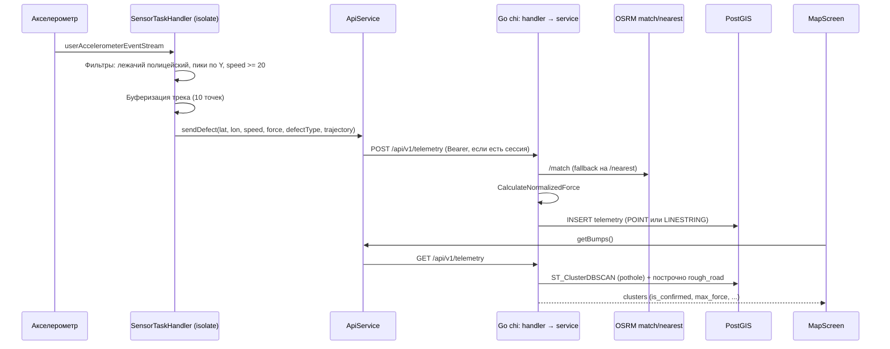
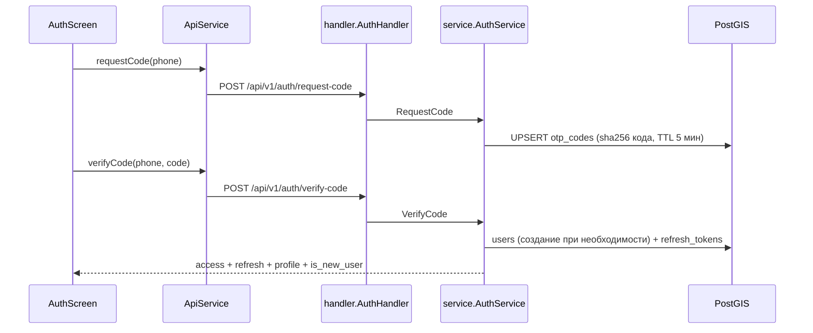

# Архитектура «Дорожного пульса»

Карта исходников монорепозитория: **роль файла** и **публичные сущности**.  
Платформенные и генерируемые каталоги (`app/android/`, `app/ios/`, `app/build/`, `.dart_tool/` и т.п.) здесь не расписываются — править их без явной нужды не нужно.

См. также: [README.md](./README.md) · [AGENTS.md](./AGENTS.md)

## 📒 Содержание

- [Общая схема](#-общая-схема)
- [Структура репозитория](#-структура-репозитория)
- [Сервис телеметрии](#-сервис-телеметрии)
- [Клиент](#-клиент)
- [Потоки данных](#-потоки-данных)
- [Границы модулей](#-границы-модулей)

## 🗺️ Общая схема



Авторизация:



## 📁 Структура репозитория

```
road_pulse/
├── app/                  # Flutter-клиент (package road_pulse)
│   ├── assets/fonts/     # Unbounded, Onest, JetBrains Mono
│   ├── assets/icon/      # logo.png
│   └── lib/              # исходники UI и сервисов
├── backend/              # Go 1.25 API (module road_pulse/backend)
│   ├── cmd/api/          # точка входа
│   └── internal/         # config, database, models, osrm, service, handler
└── docs/                 # README.md, ARCHITECTURE.md, AGENTS.md
```

## 🧱 Сервис телеметрии

```
backend/
├── cmd/api/main.go                  # сборка зависимостей, chi-роутер, graceful shutdown
├── internal/config/config.go        # Config + Load() из ENV
├── internal/database/database.go    # пул pgx, применение схемы
├── internal/models/telemetry.go     # DTO телеметрии
├── internal/models/auth.go          # DTO авторизации и профиля
├── internal/osrm/client.go          # HTTP-клиент OSRM
├── internal/service/telemetry.go    # бизнес-логика дефектов
├── internal/service/auth.go         # OTP, JWT, профиль
├── internal/handler/telemetry.go    # HTTP-обработчики телеметрии
├── internal/handler/auth.go         # HTTP-обработчики авторизации
├── internal/handler/middleware.go   # RequireAuth / OptionalAuth
├── Dockerfile                       # multi-stage: сборка Go → alpine
├── docker-compose.yaml              # postgis/postgis:15-3.3 + api
└── go.mod / go.sum
```

### cmd/api/main.go

Порядок старта: `config.Load()` → `database.Connect` → `database.InitSchema` → сборка OSRM-клиента, сервисов и обработчиков → chi-роутер → `http.Server` (read/write timeout 10 с) → ожидание `SIGINT`/`SIGTERM` с 5-секундным shutdown.

| Сущность | Тип | Назначение |
|----------|-----|------------|
| `main()` | function | Точка входа, wiring, graceful shutdown |
| `GET /health` | inline handler | `SELECT PostGIS_Version()`; `200 {status, postgis}` либо `503 {detail}` |
| Роутер | `chi.Router` | `middleware.Logger`, `middleware.Recoverer` |
| Роуты `/api/v1/auth` | group | `request-code`, `verify-code`, `refresh`; под `RequireAuth` — `GET`/`PATCH /me` |
| Роут `/api/v1/telemetry` | group | `POST` под `OptionalAuth`, `GET` без авторизации |

### internal/config/config.go

| Сущность | Тип | Назначение |
|----------|-----|------------|
| `Config` | struct | `Port`, `DatabaseURL`, `OSRMBase` |
| `Load()` | func | Чтение ENV с fallback-значениями (`PORT=8000`, публичный OSRM, локальный DSN) |

`JWT_SECRET` читается в `main.go` напрямую через `os.Getenv` и в `Config` не входит.

### internal/database/database.go

| Сущность | Тип | Назначение |
|----------|-----|------------|
| `Connect(ctx, dbURL)` | func → `*pgxpool.Pool` | Разбор DSN, `MaxConns=25`, `MinConns=2`, idle 5 мин, `Ping` с таймаутом 5 с |
| `InitSchema(ctx, pool)` | func | Идемпотентные миграции: `CREATE EXTENSION postgis`, таблицы, индексы (`idx_telemetry_user_id`, GIST по `location`, `idx_users_phone`) |

| Таблица | Ключевые поля |
|---------|---------------|
| `telemetry` | `id`, `user_id`, `location GEOMETRY(Geometry,4326)`, `speed_kmh`, `bump_force`, `defect_type`, `infrastructure_type`, `timestamp` |
| `users` | `id VARCHAR(64)` PK, `phone` UNIQUE, `name`, `city`, `car_clearance`, `created_at` |
| `otp_codes` | `phone` PK, `code_hash` (sha256), `attempts`, `expires_at`, `created_at` |
| `refresh_tokens` | `token_hash` PK, `user_id → users(id) ON DELETE CASCADE`, `expires_at`, `revoked`, `created_at` |

### internal/models/telemetry.go

| Сущность | Тип | Назначение |
|----------|-----|------------|
| `TrajectoryPoint` | struct | `lat`, `lon`, `timestamp` |
| `TelemetryPayload` | struct | Вход POST: `user_id`, `latitude`, `longitude`, `speed_kmh`, `bump_force`, `defect_type`, `infrastructure_type`, `trajectory` |
| `TelemetryResponse` | struct | Ответ POST: `status`, `id`, `snapped_lat`/`snapped_lon`, нормализованный `bump_force`, типы дефекта и инфраструктуры, `geometry_type` |
| `TelemetryCluster` | struct | Элемент ответа GET: `cluster_id`, `lat`, `lon`, `max_force`, `unique_users`, `total_hits`, `is_confirmed`, `defect_type`, `infrastructure_type` |

### internal/models/auth.go

| Сущность | Тип | Назначение |
|----------|-----|------------|
| `RequestCodePayload` | struct | `phone` |
| `VerifyCodePayload` | struct | `phone`, `code` |
| `RefreshTokenPayload` | struct | `refresh_token` |
| `UserProfile` | struct | `id`, `phone`, `name`, `city`, `car_clearance`, `created_at` |
| `AuthResponse` | struct | `access_token`, `refresh_token`, `user`, `is_new_user` |
| `UpdateProfilePayload` | struct | Указатели `name`, `city`, `car_clearance` (частичное обновление) |

> В файле остался нерабочий относительный импорт и не подключён пакет `time` — пакет моделей в текущем виде не собирается (см. ограничения в [README](./README.md)).

### internal/osrm/client.go

| Сущность | Тип | Назначение |
|----------|-----|------------|
| `Client` | struct | `baseURL` + `http.Client` с таймаутом 5 с |
| `NewClient(baseURL)` | func | Нормализует хвостовой `/` |
| `Nearest(ctx, lat, lon)` | method → `(lat, lon)` | `/nearest/v1/driving/{lon},{lat}`; при любой ошибке возвращает исходные координаты (fail open) |
| `Match(ctx, trajectory)` | method → `(wkt, geomType, ok)` | `/match/v1/driving/...?geometries=geojson&overview=full&timestamps=...`; конвертирует GeoJSON в WKT `LINESTRING`/`POINT` |

### internal/service/telemetry.go

| Сущность | Тип | Назначение |
|----------|-----|------------|
| `MinSpeedKMH` | const `20.0` | Нижний порог скорости для приёма телеметрии |
| `BaseSpeedKMH` | const `20.0` | База нормализации силы |
| `ClusterEpsDeg` | const `0.0003` | `eps` для `ST_ClusterDBSCAN` (≈ 33 м) |
| `TelemetryService` | struct | Пул `pgx` + OSRM-клиент |
| `NewTelemetryService(pool, osrm)` | func | Конструктор |
| `CalculateNormalizedForce(bumpForce, speedKMH)` | method → `float64` | `force × 20 / max(speed, 20)` |
| `ResolveLocationWKT(ctx, payload)` | method → `(wkt, geomType)` | Трек длиннее 2 точек → `/match`; `rough_road` остаётся `LINESTRING`, `pothole` усекается до первой точки; иначе `/nearest` → `POINT` |
| `SaveTelemetry(ctx, payload)` | method → `*TelemetryResponse` | Дефолты `pothole`/`road`, нормализация, `INSERT ... ST_GeomFromText($2, 4326) RETURNING id, ST_Y/ST_X(ST_Centroid(location))` |
| `GetClusters(ctx)` | method → `[]TelemetryCluster` | Два запроса: DBSCAN-кластеры ям и построчный список `rough_road` (+ смещение `1000000` к `cluster_id`) |

**Правило подтверждения кластера:** `unique_users >= 2` **или** `total_hits >= 3` (считается на стороне Go, не в SQL).

### internal/service/auth.go

| Сущность | Тип | Назначение |
|----------|-----|------------|
| `ErrInvalidCode`, `ErrCodeExpired`, `ErrTooManyAttempts`, `ErrInvalidToken`, `ErrUserNotFound` | error | Типизированные ошибки для HTTP-слоя |
| `AuthService` | struct | Пул `pgx` + `jwtSecret` |
| `NewAuthService(pool, secret)` | func | Подставляет dev-секрет, если `JWT_SECRET` пуст |
| `RequestCode(ctx, rawPhone)` | method → `(retryAfter, error)` | Генерация 4-значного кода, sha256 в `otp_codes` (UPSERT), TTL 5 мин; код печатается в лог (заглушка SMS-шлюза); возвращает 60 с |
| `VerifyCode(ctx, rawPhone, code)` | method → `*AuthResponse` | Не более 3 попыток, проверка TTL, мастер-код `1234`; создаёт пользователя (`usr_<hash16>`) при отсутствии; выдаёт access (HS256, 24 ч) и refresh (32 байта hex, sha256 в БД, 60 дней) |
| `Refresh(ctx, oldToken)` | method → `*AuthResponse` | Проверка хеша, срока и `revoked`; ротация — старый refresh помечается `revoked` |
| `ValidateAccessToken(tokenStr)` | method → `(userID, error)` | Проверка подписи HMAC и извлечение `sub` |
| `GetProfile(ctx, userID)` | method → `*UserProfile` | Чтение профиля, `ErrUserNotFound` при отсутствии |
| `UpdateProfile(ctx, userID, payload)` | method → `*UserProfile` | Частичное обновление name/city/car_clearance |
| `normalizePhone`, `hashString`, `generateAccessToken`, `generateRefreshToken` | private methods | Нормализация номера, sha256, выпуск токенов |

Определение «нового» пользователя: пустые имя **или** город.

### internal/handler/

| Файл | Сущность | Тип | Назначение |
|------|----------|-----|------------|
| `telemetry.go` | `TelemetryHandler` / `NewTelemetryHandler` | struct / func | Обёртка над `service.TelemetryService` |
| `telemetry.go` | `PostTelemetry` | method | Разбор JSON (400), порог `MinSpeedKMH` (400 `Speed too low`), подстановка `user_id` из контекста или `anonymous`, `200` с `TelemetryResponse` |
| `telemetry.go` | `GetTelemetry` | method | Массив кластеров, `500` с `detail` при ошибке |
| `auth.go` | `AuthHandler` / `NewAuthHandler` | struct / func | Обёртка над `service.AuthService` |
| `auth.go` | `RequestCode`, `VerifyCode`, `Refresh`, `GetMe`, `UpdateMe` | methods | Валидация payload, коды 400/401/404/500, ответы JSON |
| `middleware.go` | `ContextUserIDKey` | const `contextKey` | Ключ `user_id` в `context.Context` |
| `middleware.go` | `RequireAuth(authService)` | func → `func(http.Handler) http.Handler` | Обязательный `Authorization: Bearer`, иначе `401` |
| `middleware.go` | `OptionalAuth(authService)` | func → `func(http.Handler) http.Handler` | Пробрасывает `userID`, если токен валиден; гостевые запросы не блокирует |

### Dockerfile и docker-compose.yaml

- **Dockerfile**: сборка `CGO_ENABLED=0 GOOS=linux go build -ldflags="-w -s" -o /app/server cmd/api/main.go`, рантайм `alpine` с `ca-certificates` и `tzdata`, порт 8000. Базовый образ сборки — `golang:1.22-alpine`, при том что `go.mod` требует Go 1.25.
- **Compose**: `db` (`postgis/postgis:15-3.3`, том `road_pulse_data`, БД `road_pulse_db`) и `api` (сборка из Dockerfile, порт `8001:8000`, ENV `DATABASE_URL`, `PORT`, `OSRM_BASE`, `JWT_SECRET`).

## 📱 Клиент

Дизайн-система «Полотно»: две темы (светлая «бетон» и тёмная «асфальт»), шрифты Unbounded (заголовки и цифры), Onest (интерфейс), JetBrains Mono (телеметрия) — из `assets/fonts/`.

```
lib/
├── main.dart                     # entry, MyApp, themeModeNotifier, AuthGate
├── app_theme.dart                # PolotnoColors (ThemeExtension), context.colors, AppTheme
├── main_scaffold.dart            # shell + bottom nav: Карта / Дефекты / Запись / Профиль
├── map_screen.dart               # карта кластеров + капсула записи + шторка маршрута
├── list_screen.dart              # лента дефектов: сводка с Полосой, фильтры, карточки
├── detect_screen.dart            # экран «Запись»: спидометр, осциллограф, журнал, foreground task
├── pothole_details_screen.dart   # статичный макет карточки дефекта
├── profile_screen.dart           # профиль: статы, Полоса поездки, достижения, теплокарта
├── achievement_service.dart      # каталог 30 достижений + локальный прогресс
├── api_service.dart              # HTTP, токены, логи, локальная активность
├── sensor_service.dart           # background TaskHandler акселерометра
├── screens/
│   ├── auth_screen.dart          # флоу входа: старт → номер → код → имя → доступы
│   └── account_screen.dart       # аккаунт: профиль, доступы, выход
└── widgets/
    ├── glass_panel.dart          # стеклянный контейнер (цвета темы)
    ├── onboarding_panel.dart     # запрос доступов перед первым стартом службы
    └── road_ribbon.dart          # «Полоса» — лента качества покрытия
```

### main.dart

| Сущность | Тип | Назначение |
|----------|-----|------------|
| `themeModeNotifier` | `ValueNotifier<ThemeMode>` | Глобальное переключение темы (стартует с `ThemeMode.system`) |
| `main()` | entry | `ensureInitialized`, `initCommunicationPort`, `ApiService.recordAppOpen()`, `runApp` |
| `MyApp` | StatelessWidget | `MaterialApp`: светлая и тёмная темы + `themeModeNotifier`, home — `AuthGate` |
| `AuthGate` | StatefulWidget | `FutureBuilder<bool>` по `ApiService.isAuthenticated()`: ожидание → спиннер, авторизован → `MainScaffold`, иначе `AuthScreen`. На `AppLifecycleState.resumed` фиксирует вход в статистику активности |

### app_theme.dart

| Сущность | Тип | Назначение |
|----------|-----|------------|
| `PolotnoColors` | `ThemeExtension<PolotnoColors>` | Токены: `voidBg`, `asphalt`, `surf`/`surf2`, `edge`/`edge2`, `ink`/`ink2`/`ink3`, `mark*`, `s1`/`s2`/`s3` (+ `Soft`), `glass`, `glassTab`, `term`; пресеты `light` (`#EDEDEA`) и `dark` (`#08090A`) |
| `PolotnoThemeContext.colors` | extension on `BuildContext` | Доступ к токенам текущей темы |
| `AppTheme` | class | `fontUi = 'Onest'`, `fontDisplay = 'Unbounded'`, `fontMono = 'JetBrains Mono'`, `lightTheme`/`darkTheme` (Material 3) |

### main_scaffold.dart

| Сущность | Тип | Назначение |
|----------|-----|------------|
| `MainScaffold` | StatefulWidget | `IndexedStack` из `MapScreen` / `ListScreen` / `DetectScreen` / `ProfileScreen` + стеклянный таб-бар на 4 таба |
| `MainScaffold.of(context)` | static | Доступ к состоянию из потомков |
| `MainScaffoldState.switchTab(index)` | method | Переключение вкладки (используется картой для переходов) |

### map_screen.dart

| Сущность | Тип | Назначение |
|----------|-----|------------|
| `MapScreen` | StatefulWidget | `onNavigateToTab` — колбэк перехода на другую вкладку |
| `_locateUser` / `_loadBumps` | private methods | GPS-позиция и `ApiService.getBumps()` |
| `_buildCircles` | method | Подтверждённые кластеры: ореол и ядро, радиус и цвет по `max_force` (`> 30` — s3, `> 20` — s2, иначе s1) |
| `_buildMarkers` | method | Неподтверждённые кластеры — полые серые кружки |
| `_buildRecordCapsule` / `_buildSearchBar` / `_buildFloatingActionBtn` | methods | Верхние оверлеи карты (капсула «ЗАПИСЬ», поиск «Куда едем?», кнопки «где я» и слои) |
| `_buildDraggableSheet` | method | `DraggableScrollableSheet` (`0.22`/`0.38`/`0.85`): Полоса, стат-пилюли и «Ближайшие дефекты» — макет; `_buildDefectRow` рендерит захардкоженные строки |

Тайлы: `tile.openstreetmap.org`, в тёмной теме — `darkModeTileBuilder`.

### list_screen.dart

| Сущность | Тип | Назначение |
|----------|-----|------------|
| `ListScreen` | StatefulWidget | Лента: сводка (всего и подтверждено + Полоса по `max_force`) и карточки дефектов |
| `_filters` / `_applyFilter` | field / method | Чипы «Сегодня / Неделя / Месяц / Всё время» и сортировка по дате |
| `_parseDate` | method | `created_at` → `timestamp` → `DateTime.now()`: API дату не отдаёт, поэтому фильтры работают как заготовка |
| `_getAddress` | method | Обратное геокодирование (`geocoding`) для заголовка карточки |
| `_buildDefectCard` | method | Плейсхолдер-превью с бейджем S/M/L, координаты, `max_force` → РОВНО/ЗАМЕТНО/ЖЁСТКО, счётчик подтверждений, «Объезд», переход в `PotholeDetailsScreen` |
| `_buildEmptyState` / `RefreshIndicator` | widgets | Пустое состояние и обновление жестом |

### detect_screen.dart

| Сущность | Тип | Назначение |
|----------|-----|------------|
| `DetectScreen` | StatefulWidget | Экран «Запись»: реальные GPS и акселерометр, старт и остановка foreground-службы |
| `_checkPermissionsAndStart` | method | Автостарт при выданном доступе, иначе пуш `OnboardingPanel` |
| `_initForegroundTask` | method | `FlutterForegroundTask.init`: канал уведомлений с прежним ID проекта, `eventAction.repeat(5000)`, wake/wifi lock |
| `_toggleTracking` | method | `startService(callback: startCallback)` / `stopService` |
| `_onReceiveTaskData` | method | Логи из isolate → `ApiService.addLog` |
| `_initSensors` | method | Стримы позиции (distanceFilter 2) и `userAccelerometer`; при скорости ≥ 20 км/ч и активной записи копит километраж в `AchievementService` |
| `_buildSpeedometer` / `_buildGateBanner` | methods | Крупная скорость и подсказка про порог 20 км/ч |
| `_buildScope` / `PolotnoScopePainter` | widget / CustomPainter | Осциллограф оси Z с пунктирным порогом 7 g (`_drawDashedLine`) |
| `_buildTerminal` | method | Журнал событий из `ApiService.logs` (последние 6 строк, классификация по префиксам) |

### profile_screen.dart

| Сущность | Тип | Назначение |
|----------|-----|------------|
| `ProfileScreen` | StatelessWidget | Секции: заголовок с инициалами из `ApiService.getUserProfile()`, бейдж сообщества, 4 стата (заглушки), Полоса последней поездки (макет), достижения, теплокарта |
| `_buildAchievements` / `_showAchievementsSheet` | methods | Топ-8 достижений и шит «Все 30» (`_AllAchievementsSheet`) |
| `_buildActivityHeatmap` | method | Сетка 28 дней из `ApiService.getActivityData()` (серия, входы, активные дни) |
| `_formatStreak` / `_formatVisits` | static methods | Русские формы числительных |

### pothole_details_screen.dart

| Сущность | Тип | Назначение |
|----------|-----|------------|
| `PotholeDetailsScreen` | StatelessWidget | Полностью статичный макет: `SliverAppBar` с превью, бейдж силы, адрес, 3 факта, профиль удара, правило подтверждения, мини-карта, действия, комментарии |
| `ImpactSpikePainter` | CustomPainter | График профиля удара |
| `MiniRoadPainter` | CustomPainter | Схематичная мини-карта |

Экран не принимает данных: и карта, и лента открывают его без параметров.

### achievement_service.dart

| Сущность | Тип | Назначение |
|----------|-----|------------|
| `Achievement` | class | `id`, `category`, `title`, `description`, `icon`, `current`, `target`, `isUnlocked`, `progressRatio` |
| `AchievementService.categories` | const list | «Все», «Старт», «Водитель», «Житель», «Порядочный гражданин», «Моя яма», «Доверие и сообщество» |
| `getAchievements()` | static Future | Каталог 30 достижений и прогресс из `SharedPreferences` (серия дней подтягивается из активности) |
| `addDistanceMeters(meters)` | static Future | Накопление километража, зачёт `first_km` и `thousand` |
| `checkCarProfile({model, tires, clearance})` | static Future | Зачёт `car_profile` |
| `increment(id, [delta])` | static Future | Инкремент произвольной записи прогресса |
| `_catalog`, `_loadRawProgress`, `_saveRawProgress` | private | Каталог и хранилище (стартовые значения для `first_km`, `first_find`, `sharp_eye`, `thousand`) |

### api_service.dart

| Сущность | Тип | Назначение |
|----------|-----|------------|
| `ApiService` | class (static) | Единая точка HTTP, токенов, логов и локальной активности |
| `baseUrl` / `apiUrl` | const | Базовый адрес API и путь телеметрии |
| `logs` | `ValueNotifier<List<LogEntry>>` | Буфер журнала для экрана «Запись» |
| `addLog(raw)` | static | Чистит эмодзи-префиксы isolate и классифицирует запись в `LogKind.ok`/`hit`/`warn` |
| `LogEntry` / `LogKind` | class / enum | Строка журнала: время, текст, вид |
| `VerifyResult` | class | `success`, `isNewUser`, `errorMessage` |
| `DayActivity` / `UserActivityData` | class | Ячейка теплокарты (уровни 0–3) и агрегат за 28 дней (серия, входы, активные дни) |
| `recordAppOpen()` / `getActivityData()` | static Future | Учёт входов в `SharedPreferences` (хранение 90 дней) и сборка сетки 28 дней |
| `requestCode(phone)` / `verifyCode(phone, code)` | static Future | Авторизация; сохранение access/refresh токенов и профиля |
| `updateProfile({name, city, clearance})` | static Future | Локальное сохранение и `PATCH /auth/me` при наличии токена |
| `getAccessToken()` / `isAuthenticated()` / `getUserProfile()` / `logout()` | static Future | Работа с сессией (токены и профиль в `SharedPreferences`) |
| `sendDefect({...})` | static Future\<bool\> | `POST /api/v1/telemetry` с `Bearer`, если токен есть; принимает `defectType`, `infrastructureType`, `trajectory` |
| `getBumps()` | static Future\<List\<Map\>\> | `GET /api/v1/telemetry` |

`user_id` в теле POST не отправляется — сервис берёт его из JWT или помечает запись как `anonymous`.

### sensor_service.dart

| Сущность | Тип | Назначение |
|----------|-----|------------|
| `startCallback()` | entry-point (`@pragma('vm:entry-point')`) | Регистрация `SensorTaskHandler` в isolate foreground-задачи |
| `TrajectoryPoint` | class | Точка трека (`lat`, `lon`, `timestamp`) и `toJson()` |
| `SensorTaskHandler` | `TaskHandler` | Фоновый isolate: подписки на позицию (distanceFilter 5) и `userAccelerometer` |
| `SensorTaskHandler.bumpThreshold` | static const `7.0` g | Порог удара (используется и графиком экрана «Запись») |
| `_isSpeedBump(zForce)` | method | Игнор лежачих полицейских: пик по Z > 5.0 g длительностью < 300 мс → пауза 500 мс |
| `_detectRoughRoad(yForce)` | method | Более 4 пиков по Y > 4.0 g за 5 с → `rough_road`, сила `пики × 2`, диапазон 20–40 км/ч, блокировка на 5 с |
| `_detectPothole(event)` | method | `force = sqrt(x² + y² + z²) > 7.0` → `pothole`, скорость ≥ 20 км/ч, пауза 2 с |
| `_sendDefectData({...})` | method | `Geolocator.getCurrentPosition`, перевод в км/ч, фильтр по скорости, `ApiService.sendDefect` с буфером трека, отчёт в UI через `sendDataToMain` |
| `_updateTrajectory(position)` | method | Скользящий буфер последних 10 точек |
| `_pauseMonitoring(ms)` | method | Временная блокировка детекции |
| `onStart` / `onRepeatEvent` / `onDestroy` | overrides | Жизненный цикл задачи: старт стримов, отмена подписок |

### screens/auth_screen.dart

| Сущность | Тип | Назначение |
|----------|-----|------------|
| `AuthStep` | enum | `start`, `phone`, `code`, `codeError`, `name`, `access` |
| `AuthScreen` | StatefulWidget | Пошаговый вход через `switch (_step)` в `build` |
| `_handleRequestCode` | method | `ApiService.requestCode`, таймер повторной отправки 60 с |
| `_handleVerifyCode` | method | `ApiService.verifyCode`; новый пользователь → шаг `name`, существующий → `MainScaffold`; ошибка → `codeError` |
| `_handleSaveProfileAndContinue` | method | Валидация имени и города, `ApiService.updateProfile`, переход к `access` |
| `_onKeyPress` / `_buildKeypad` | methods | Своя цифровая клавиатура для шагов «номер» и «код» |
| `_formatPhone` | method | Маска `(###) ###-##-##` при префиксе `+7` |
| `_buildStartStep` / `_buildPhoneStep` / `_buildCodeStep` / `_buildNameStep` / `_buildAccessStep` | methods | Экраны шагов: оффер, номер, 4 ячейки кода, имя/город/клиренс, список доступов |

### screens/account_screen.dart

| Сущность | Тип | Назначение |
|----------|-----|------------|
| `AccountScreen` | StatefulWidget | Секции «ВХОД», «ЗАПИСЬ», «ОПАСНАЯ ЗОНА» и строка версии |
| `_loadProfile` | method | `ApiService.getUserProfile()` и марка/шины из `SharedPreferences` |
| `_showEditProfileDialog` | method | Диалог: имя, город, марка и модель, шины, клиренс; сохранение локально, зачёт `car_profile`, `PATCH /auth/me` |
| `_handleLogout` | method | `ApiService.logout()` → `AuthScreen` (используется и для «Удалить аккаунт») |
| `_buildGroupCard` / `_buildRowItem` / `_buildSectionHeader` | methods | Карточки-группы настроек |

### widgets/

| Сущность | Тип | Назначение |
|----------|-----|------------|
| `glass_panel.dart` → `GlassPanel` | widget | Blur и полупрозрачный `surf` с рамкой `edge`; параметры `blur`, `opacity`, `borderRadius`, `padding` |
| `onboarding_panel.dart` → `OnboardingPanel` | widget | Экран запроса доступов перед первым стартом службы (`onAllow`), анимация fade/slide, «магнитная» кнопка `_MagneticAllowButton` |
| `road_ribbon.dart` → `RoadRibbon` / `RibbonSegment` | widget / class | Лента качества из сегментов (`flex`, `color`) с маркером «вы здесь» (`currentPosition`) |

## 🔄 Потоки данных

### Запись ямы

1. `SensorTaskHandler.onStart` → стримы позиции и акселерометра.
2. `_isSpeedBump` отсекает лежачих полицейских; `_detectRoughRoad` и `_detectPothole` решают, что это дефект.
3. `Geolocator.getCurrentPosition` и перевод скорости в км/ч; фильтр ≥ 20 км/ч (для `rough_road` ещё и ≤ 40).
4. `ApiService.sendDefect(...)` → `POST /api/v1/telemetry` с `Bearer`, если есть сессия.
5. Сервис: `ResolveLocationWKT` (OSRM) → `CalculateNormalizedForce` → `INSERT` в PostGIS.

### Чтение карты и ленты

1. `MapScreen._loadBumps` / `ListScreen._loadBumps` → `ApiService.getBumps()`.
2. `GET /api/v1/telemetry` → кластеры `pothole` и записи `rough_road`.
3. Карта: `is_confirmed` → цветной `CircleMarker` (цвет и радиус по `max_force`), иначе полый `Marker`.
4. Лента: карточка с адресом (`geocoding`), степенью по `max_force` и счётчиком подтверждений.

### Вход

1. `AuthScreen` → `ApiService.requestCode` → код в БД и в лог сервиса.
2. `verifyCode` → `AuthResponse`; токены и профиль в `SharedPreferences`.
3. `is_new_user` → шаг заполнения профиля, иначе сразу `MainScaffold`.
4. `AuthGate` при следующем запуске видит токен и открывает `MainScaffold`.

## 🚧 Границы модулей

| Слой | Должен делать | Не должен |
|------|----------------|-----------|
| `sensor_service` | Датчики, пороги, вызов API | UI, тема |
| `api_service` | HTTP, токены, буфер логов | Виджеты, бизнес-пороги датчиков |
| Экраны (`*_screen`) | UI и навигация | Дублировать HTTP-логику (только через `ApiService`) |
| `handler` | HTTP: разбор запроса, коды ответов | SQL и бизнес-правила |
| `service` | Бизнес-логика: нормализация, кластеры, OTP, JWT | Формирование HTTP-ответов |
| `models` | DTO и JSON-теги | Логика и доступ к БД |
| `database` | Пул соединений и схема | HTTP и бизнес-логика |
| `osrm` | Внешний HTTP с timeout и fallback | Знание о схеме БД |

При добавлении файла или публичной функции — обновите этот документ.
